# Automated Response to RDP Brute Force with Wazuh Active Response

A hands-on lab that extends my [RDP brute-force incident response lab](https://github.com/AhmeeMian645/nist-csf-incident-response-lab). In that lab I detected the attack and blocked the attacker **manually**. Here the response is **automatic**: Wazuh detects repeated failed RDP logons, blocks the attacker's IP in Windows Firewall, and unblocks it after a timeout.

## Objective
Detect an RDP password-guessing attack and contain it automatically, without blocking legitimate users who mistype a password.

## Environment
| Component | Details |
|---|---|
| Wazuh manager | Ubuntu Server (`ubuntu-soc`), v4.14.9 |
| Wazuh agent | Windows host (`Win_agent`, ID 001), v4.14.9 |
| Attacker | Kali Linux VM, Hydra v9.7 |
| Network | Isolated host-only lab network (192.168.56.0/24) |

## How it works
| Step | Component | In this lab |
|---|---|---|
| Trigger | Wazuh rule | Rule **60204** "Multiple Windows Logon Failures" (8 failures within the rule's time window) |
| Decision | Rule threshold | Fewer than 8 failures do not trigger the response |
| Action | Active response | Built-in `netsh` script blocks the source IP in Windows Firewall |
| Safety | Timeout | Block is removed automatically after 120 seconds |

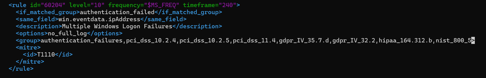

**Framework mapping:** MITRE ATT&CK **T1110 Brute Force** (Credential Access), as tagged by the rule. NIST CSF 2.0: Detect, then Respond → Incident Mitigation (RS.MI-01, incidents are contained).

## Configuration
Manager `/var/ossec/etc/ossec.conf`. The `netsh` command is defined by default:

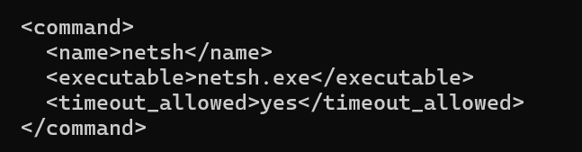

The active response block (also in [`config/ossec-active-response.xml`](config/ossec-active-response.xml)):

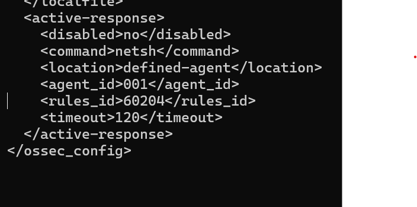

## Test 1: false positive (normal user mistyping)
I attempted 2 wrong passwords. The rule did not fire and no block was created, because the attempts stayed below the rule's threshold.

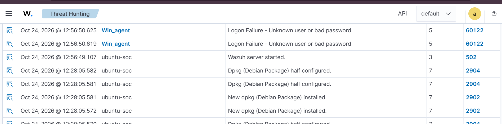

## Test 2: brute-force attack
Attack from Kali:
```bash
hydra -l testuser(or zaman) -P /usr/share/wordlists/rockyou.txt -t 1 -W 2 -s 3389 -vV rdp://192.168.56.1
```

**Detection and response.** Failed logons (60122) accumulated, rule 60204 fired, and about one second later the active response ran (rule 657, `netsh.exe - add`):

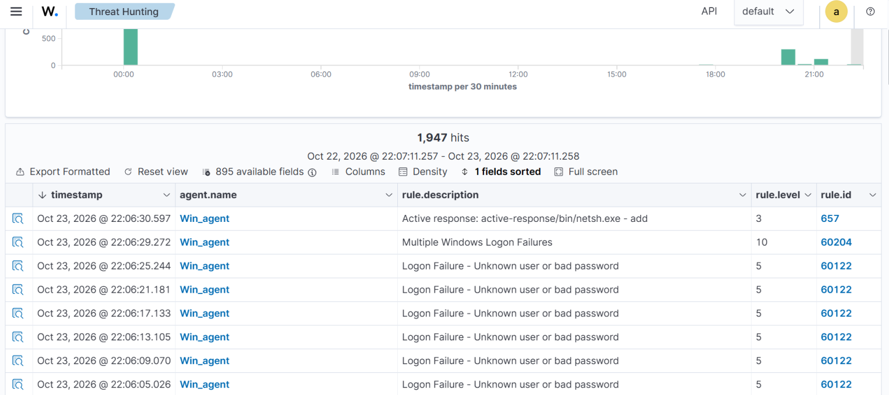

The response alert carries the attacker IP (`data.srcip`):

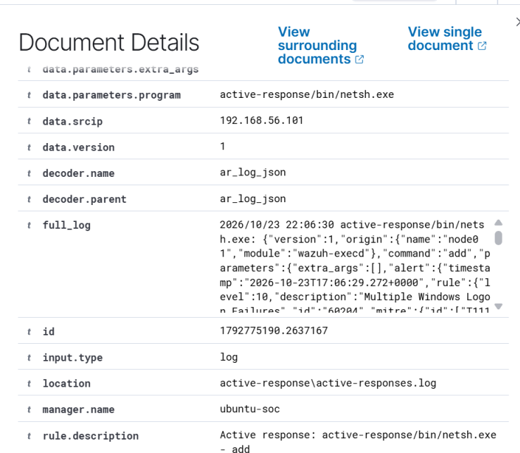

The agent log shows the script identifying the IP (`check_keys`):

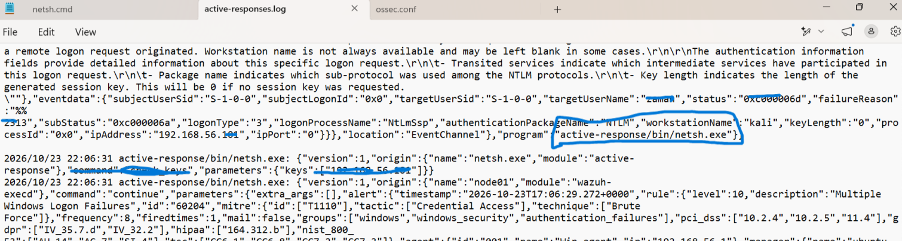

**Containment.** Windows Firewall rule created by Wazuh for the attacker IP:

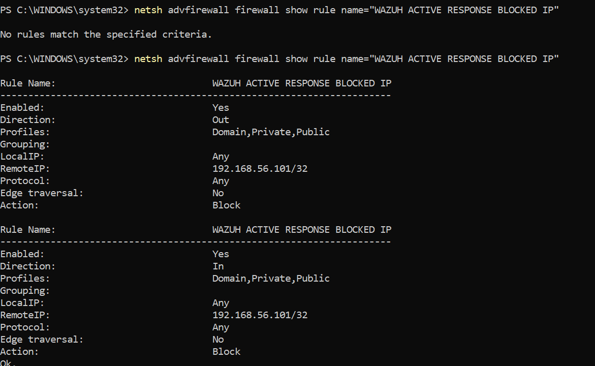

Hydra was cut off:

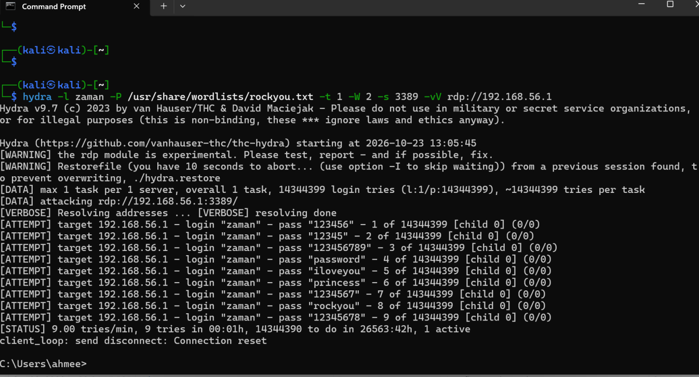

The Wazuh netsh script blocks traffic in both directions, so my SSH session to the Kali VM also dropped. `connect to host ... Permission denied` means Windows refused the connection attempt (firewall block), not that a login failed:

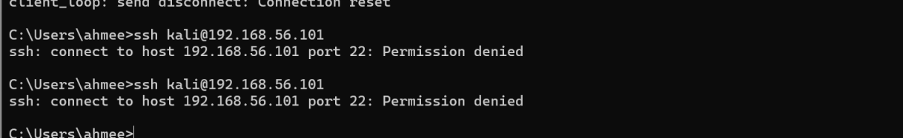

**Auto-unblock.** The block was removed exactly 120 seconds after it was added (657 `add` at 22:29:31, 657 `delete` at 22:31:31):

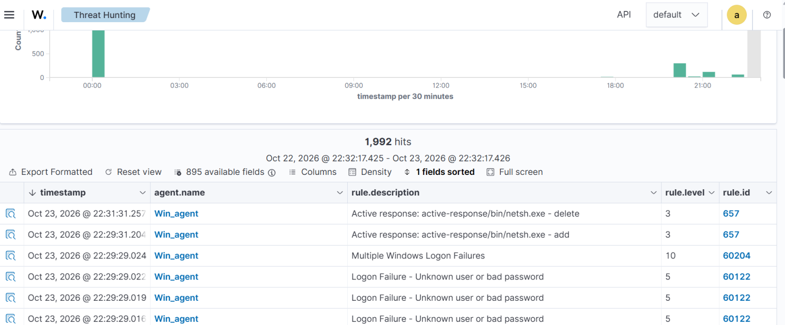

Connectivity was restored:

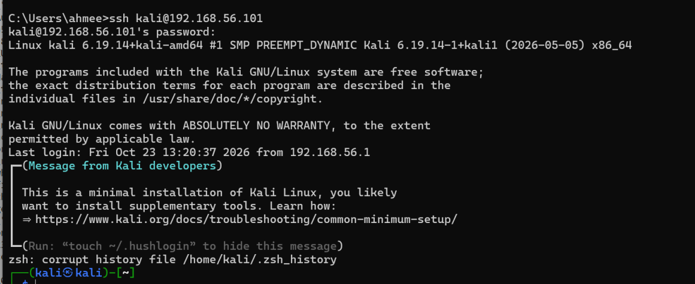

## Troubleshooting: "Cannot read 'srcip' from data"
**Problem.** On Wazuh 4.14.7 the rule fired and the order reached the agent, but no block was created. The agent log showed:

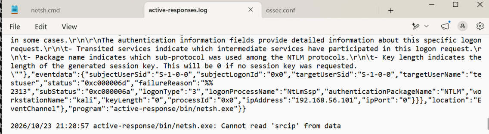

**Investigation.** I checked the alert fields (the attacker IP was present in the event data), the agent's `active-responses.log`, and the `netsh` source code.

**Root cause.** A known bug: since v4.14.7 the Windows `netsh` and `route-null` active responses failed with this error because the IP validation called `getaddrinfo()` without initializing Winsock. It is listed as fixed in the Wazuh 4.14.9 release notes (issue #40084).

**Fix.** I upgraded the manager and Windows agent to 4.14.9. The response then worked as shown above.

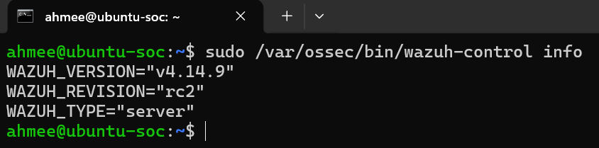

## Limitations
- No allowlist yet: a legitimate host that triggers the rule would also be blocked for 120 seconds.
- The block applies to one IP on one host's firewall, in both directions.
- The threshold comes from the default rule and was not tuned.
- Hydra's RDP module is experimental; results in other environments may differ.

## Next steps
- Add an allowlist and tune thresholds to reduce false positives.
- Add enrichment and an analyst approval step with an orchestration tool (Shuffle) for a fuller SOAR workflow. 

## Author
Muhammad Ahmad, aspiring SOC / Blue Team analyst. [GitHub](https://github.com/AhmeeMian645) · [LinkedIn](https://www.linkedin.com/in/muhammad-ahmad-cyberse)
